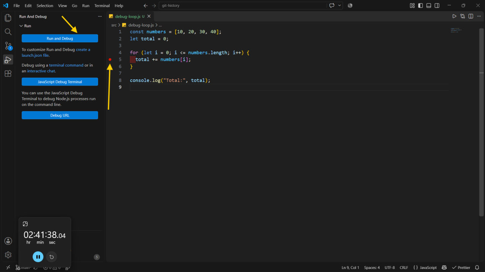
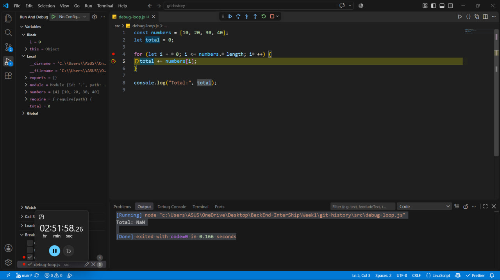
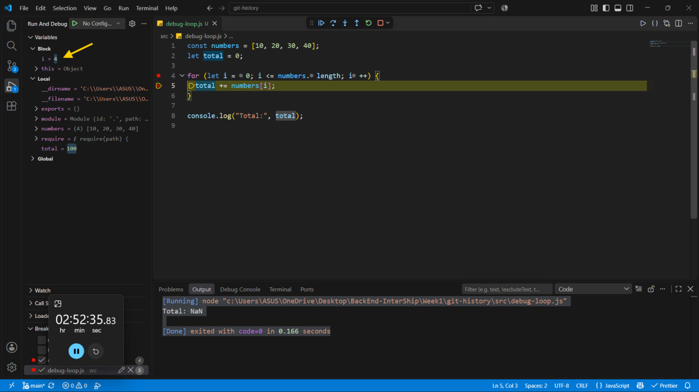

## Debugging Process & Bug Fix

## 1. المشكلة الأساسية (The Bug)

عند محاولة جمع عناصر المصفوفة باستخدام حلقة تكرار `for`، وقعنا في خطأ برمجي ناتج عن استخدام علامة `<=` في شرط التوقف بدلاً من `<`:

```javascript
for (let i = 0; i <= numbers.length; i++) {
  total += numbers[i];
}
```

هذا الخطأ أدى إلى محاولة جلب عنصر غير موجود numbers[4] والذي يعيد القيمة undefined، مما جعل النتيجة النهائية NaN

## الحطوات:

اولا وضع الـ breakpoints وتشغيل الـ debugging

تم وضع نقطة التوقف (Breakpoint) عند سطر التجميع داخل الحلقة بهدف مراقبة تغير القيم وتتبع الفهرس خطوة بخطوة في كل دورة لاكتشاف سبب ظهور القيمة NaN بدقة.



وبعد تشغيل الـ debugging

تظهر لدينا تافذة عن طريقها يمكننا تتبع قيم المتغيرات



عندما تم تنفيذ numbers[4] أصبحت القيمة undefined، وتحول المتغير total مباشرة إلى NaN، وهو الدليل على وجود خطأ في شرط الحلقة.

## 
